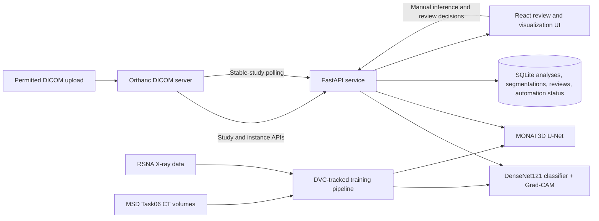

# Architecture

The local demo runs Orthanc, FastAPI, and the React app as separate Compose
services. Ports are bound to loopback. CR/DX classifier inference processes
the first instance; CT segmentation selects the largest CT series in a study,
sorts its slices by physical position, resamples the volume, and displays a
central model-space slice. The SQLite database stores output summaries and
review records, not patient metadata or image files.

## Trust and data boundaries

- DICOM files remain in the local Orthanc storage volume.
- Model training inputs and checkpoints are excluded from Git; DVC stores data
  in its local cache until an approved private remote is configured.
- The browser calls the local API. The API accesses Orthanc using local
  development credentials.
- This prototype has no user authentication, authorization, tamper-evident
  audit controls, or clinical safety controls.
